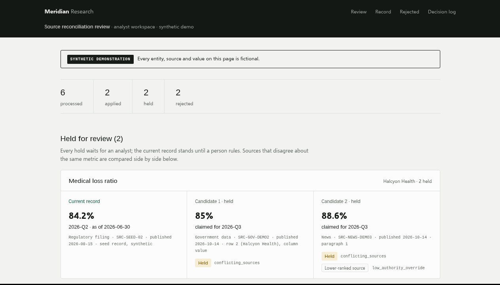

# Source-backed record reconciliation

A small working demo I built while applying to Soria: their core loop is
turning messy source updates into a continuously updated, source-backed
record, so I built a version of that loop for a fictional healthcare research
team tracking three fictional companies. All data is synthetic.



## What it does

- Ingests a source update: a CMS-style CSV extract, a filing excerpt, a news
  brief, or an analyst spreadsheet note (plain-text slice only).
- An LLM extractor (Claude CLI) pulls out a structured candidate: entity,
  metric, value, unit, period, publication date, source type, and the exact
  citation (page, row, or paragraph) where the value appears.
- A deterministic rule pack (`rule-pack.md`, written like an internal SOP)
  decides what happens: **apply** (authoritative, newer, consistent), **hold
  for analyst review** (conflicting sources, stale source, unit or definition
  change, an implausibly large jump, a low-authority source overriding a
  better one), or **reject** (no usable citation, unknown entity).
- Every record value keeps its source and citation. Every decision lands in an
  audit log with its reason; an applied value records what it supersedes.
  `review_page.py` renders the record, the review queue, and the decision log
  as one HTML page.

The holds are the point: the system abstains with a stated reason instead of
writing a bad value into the record.

## Quickstart

Requires Python 3.9+ (standard library only). The extraction steps need the
`claude` CLI; everything else runs without it.

```
python3 -m unittest -v                                  # 19 tests
python3 run_demo.py --mode mock --outdir out-demo       # no model calls
open out-demo/review.html                               # the page above

python3 run_demo.py --mode claude --outdir out-demo     # real extraction
python3 run_holdout.py --corpus corpus-dev-12-v2.json --mode claude --outdir out-dev
```

## Test results (actual runs)

| Suite | Result |
| --- | --- |
| Unit tests | 19/19 pass |
| Dev set (12 cases, real extraction) | 12/12 decisions, 0 wrong auto-applies |
| Frozen holdout (33 cases, run once after code freeze) | 33/33 decisions (14 applied / 14 held / 5 rejected), 0 wrong auto-applies |

Honest caveats: both test sets are my own synthetic cases, revised once to
state periods explicitly after dev testing showed two ambiguous cases.
Same-author tests are not an independent benchmark, the cases use clearly
stated periods and plain text, and performance on messy real inputs is
untested. The graded 33-case holdout is kept out of this repo on purpose so
future runs stay meaningful - happy to share it directly. Field-level note:
one scorer field (entity) disagreed on the unknown-entity case, which was
still correctly rejected; decision-level results were unaffected.

## Layout

```
reconcile.py          deterministic rule engine (the SOP, as code)
rule-pack.md          the SOP in plain English
extract_candidate.py  LLM extractor wrapper (claude CLI)
run_holdout.py        corpus harness + scorer
run_demo.py           end-to-end demo runner
review_page.py        renders the review surface (HTML)
test_reconcile.py     19 unit tests
record.json           seed record (synthetic)
registry.json         entity registry with aliases
corpus-dev-12-v2.json dev test set (same-author)
demo_docs/            six curated synthetic source updates
docs/                 write-up and screenshot
```

## Provenance

The demo was evaluated on 2026-11-09 (results above) before this repo was
assembled; the repo adds input-validation hardening on top of the evaluated
code, with decision logic unchanged and the full suite re-run. The two commits
show the difference.

## Limitations

- Plain-text and CSV-style inputs only: no PDF parsing, real spreadsheet
  formats, or live feeds.
- Entity resolution is a small alias registry, nothing more.
- The audit log is append-only within a run; it is not tamper-proof.

