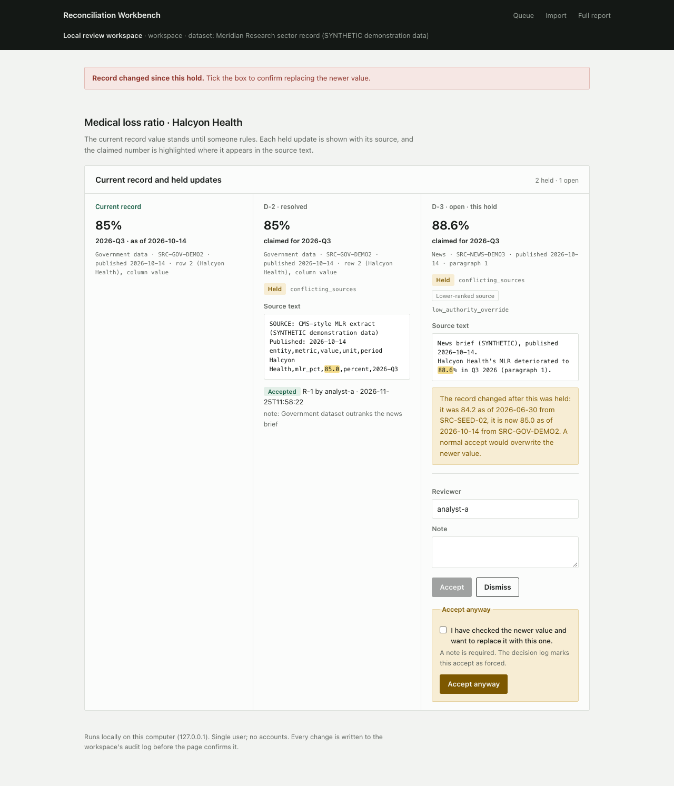

# Reconciliation Workbench

A local tool for keeping a source-backed record up to date. Extracted updates
are applied, held for review, or rejected by deterministic rules; every value
keeps its source and citation; and an analyst works through the holds in a
small browser app, comparing each claim with its source text before accepting
or dismissing it. Everything is written to an append-only audit log.

All bundled data is synthetic: a fictional research team ("Meridian Research")
tracking three fictional companies. The project began as a work sample for a
job application and is now developed as a standalone tool; it is not
affiliated with or endorsed by any company.



## What it does

- Ingests a source update: a CMS-style CSV extract, a filing excerpt, a news
  brief, or an analyst spreadsheet note (plain-text slice only).
- An LLM extractor (Claude CLI) pulls out a structured candidate: entity,
  metric, value, unit, period, publication date, source type, and the exact
  citation (page, row, or paragraph) where the value appears.
- A deterministic rule pack (`rule-pack.md`, written like an internal SOP)
  decides what happens: **apply** (authoritative, newer, consistent), **hold
  for analyst review** (conflicting sources, stale source, unit or definition
  change, an implausibly large jump, a low-authority source overriding a
  better one), or **reject** (no usable citation, unknown entity).
- Every record value keeps its source and citation. Every decision lands in an
  audit log with its reason; an applied value records what it supersedes.
  `review_page.py` renders the record, the review queue, and the decision log
  as one HTML page.

The holds are the point: the system abstains with a stated reason instead of
writing a bad value into the record.

## Quickstart

Requires Python 3.9+ (standard library only). The extraction steps need the
`claude` CLI; everything else runs without it.

```
python3 -m unittest -v                                  # 113 tests
python3 run_demo.py --mode mock --outdir out-demo       # no model calls
open out-demo/review.html                               # the page above

python3 run_demo.py --mode claude --outdir out-demo     # real extraction
python3 run_holdout.py --corpus corpus-dev-12-v2.json --mode claude --outdir out-dev
```

## Review app (local browser)

```
python3 app.py ws-demo --init        # creates ws-demo from the synthetic seed
open http://127.0.0.1:8765/
```

1. **Import**: choose `demo-candidates.json`, the manifest
   `demo_docs/manifest.json` and the six `demo_docs/*.txt` source files.
   The queue then shows 2 applied, 2 held, 2 rejected.
2. **Review**: each hold opens a side-by-side comparison of the current
   record and every held update for that metric, with the claimed number
   highlighted in its stored source text.
3. **Resolve**: accept or dismiss with your name and a note. If the record
   changed after the hold was raised, plain Accept is disabled; "Accept
   anyway" needs a ticked confirmation and a note, and is marked as forced.
4. **Refusals** (duplicate import, already resolved, stale accept, another
   command holding the workspace) are explained on the page and change
   nothing. A damaged audit log switches the app to read-only.

The app keeps no state of its own: every request reads the workspace under
its lock, so a restart loses nothing that was confirmed, and an interrupted
change is completed (and announced) when the workspace is next opened. It
binds to 127.0.0.1 only and checks Host, Origin and a per-process form token
on every change. One request is served at a time; an upload whose body has
not fully arrived within 10 seconds is abandoned. `python3 tools/browser_check.py NEW_FOLDER` runs the
whole flow above in headless Chrome (desktop and 390px screenshots) and fails
on any unmet step; it needs a local Chrome (default path is the macOS one; use
`--chrome PATH` elsewhere) and writes only into NEW_FOLDER.

## Review workflow (command line)

`run_demo.py` is one-shot: every run starts again from the seed record.
`workspace.py` keeps state on disk so holds can actually be worked through:

```
python3 workspace.py init ws-demo                       # copy seed record + registry
python3 workspace.py ingest ws-demo --candidates demo-candidates.json \
    --manifest demo_docs/manifest.json                  # 2 applied, 2 held, 2 rejected
python3 workspace.py queue ws-demo                      # open holds with ids (D-2, D-3)
python3 workspace.py resolve ws-demo D-2 --accept --reviewer NAME --note "why"
python3 workspace.py resolve ws-demo D-3 --dismiss --reviewer NAME
python3 workspace.py render ws-demo                     # ws-demo/review.html
python3 workspace.py status ws-demo
```

- The audit log (`audit.jsonl`) is the source of truth: each engine decision
  gets an id `D-n`, each analyst resolution `R-n` with reviewer and note.
  The queue is the holds with no resolution.
- Accepting a hold writes its value (with citation) into the record and logs
  what it superseded; dismissing leaves the record unchanged.
- If the record value changed after a hold was raised (for example the
  other side of a conflict was accepted), `--accept` is refused unless you
  add `--force`; forced accepts are marked in the log.
- Later ingests are decided against the record as it stands, in batch order.
  Every candidate needs a batch id (field, manifest, or `--batch NAME`); a
  batch id or an exact file that was already ingested is refused. A batch id
  is used up once ingested, even if every candidate in it was rejected:
  resubmit corrections under a new id. Integer and string ids are the same
  (`1` and `"1"` are one batch).
- With `--manifest`, each candidate's value is checked against its source
  document text; a value the document never states is held
  (`value_not_in_source`), and a candidate whose source is not in the
  manifest is held (`source_not_found`).
- One writer at a time (lock file); each change is journaled and rolled
  forward if interrupted; files are replaced atomically. Refused commands
  change nothing.

The CLI and the app share the same workspace code. This is a single-user
local tool: no accounts, access control or tamper-proofing.

## Test results (actual runs)

| Suite | Result |
| --- | --- |
| Unit tests | 113/113 pass |
| Browser check (`tools/browser_check.py`, headless Chrome) | 12/12 workflow steps, plus a no-horizontal-overflow check at 1280px and 390px for each (36/36 checks) |
| Dev set (12 cases, real extraction) | 12/12 decisions, 0 wrong auto-applies |
| Frozen holdout (33 cases, run once after code freeze) | 33/33 decisions (14 applied / 14 held / 5 rejected), 0 wrong auto-applies |

Honest caveats: both test sets are my own synthetic cases, revised once to
state periods explicitly after dev testing showed two ambiguous cases.
Same-author tests are not an independent benchmark, the cases use clearly
stated periods and plain text, and performance on messy real inputs is
untested. The graded 33-case holdout is kept out of this repo on purpose so
future runs stay meaningful. Field-level note:
one scorer field (entity) disagreed on the unknown-entity case, which was
still correctly rejected; decision-level results were unaffected.

## Layout

```
reconcile.py          deterministic rule engine (the SOP, as code)
rule-pack.md          the SOP in plain English
extract_candidate.py  LLM extractor wrapper (claude CLI)
run_holdout.py        corpus harness + scorer
run_demo.py           end-to-end demo runner (one-shot)
workspace.py          persistent review workspace (library + CLI)
app.py                local browser app over a workspace
review_page.py        renders the static review report (HTML)
test_*.py             tests (engine, review page, workspace, app over HTTP)
tools/browser_check.py  end-to-end check in headless Chrome
record.json           seed record (synthetic)
registry.json         entity registry with aliases
corpus-dev-12-v2.json dev test set (same-author)
demo_docs/            six curated synthetic source updates
docs/                 original write-up and screenshots
```

## Provenance

The demo was evaluated on 2026-11-09 (results above) before this repo was
assembled; the repo adds input-validation hardening on top of the evaluated
code, with decision logic unchanged and the full suite re-run. The two commits
show the difference.

The review-workspace change after that does alter engine behaviour, for inputs
the evaluated runs did not contain: malformed values (NaN, infinity, strings,
booleans, oversized integers), non-boolean citation flags, non
`YYYY-MM-DD` dates and padded metric names are now rejected; malformed or
uncited candidates no longer count as batch peers; two equally ranked
duplicates no longer both apply; batches are decided in order against the
updated record; and an optional value-in-source check holds values the source
document does not state. Re-run after the change: dev set
in mock mode 12/12 decisions, 0 wrong auto-applies, and all 12 dev values are
found in their documents. The frozen holdout was not re-run; the table above
describes the evaluated version.

## Limitations

- Plain-text and CSV-style inputs only: no PDF parsing, real spreadsheet
  formats, or live feeds.
- Entity resolution is a small alias registry, nothing more.
- The audit log is append-only; it is not tamper-proof.
- The workspace and app are single-user and local; no accounts or
  concurrent multi-user editing.
- The value-in-source check matches numbers literally (e.g. `$2.15 billion`
  will not match `2150`); such values are held for review, not applied.

